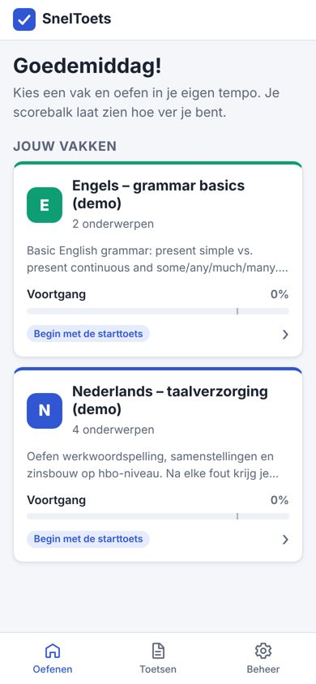
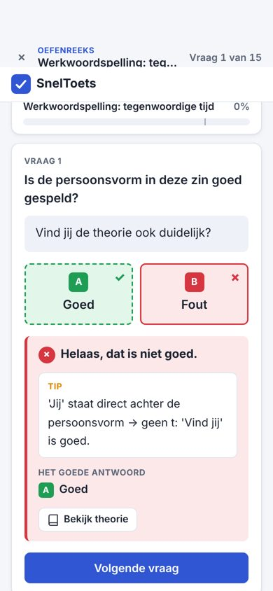
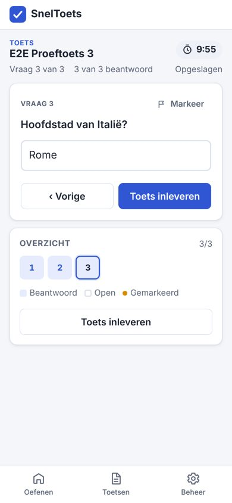
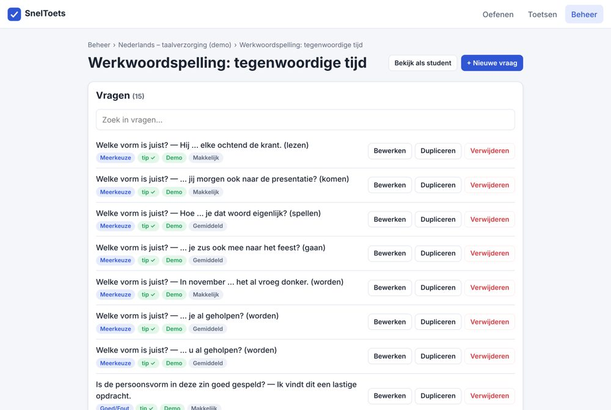
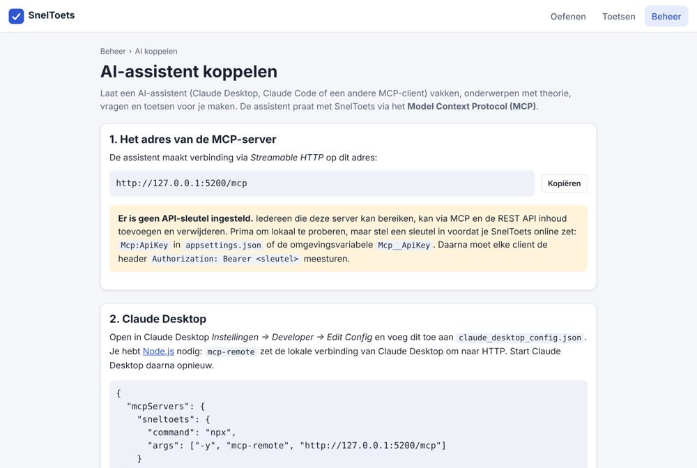

# SnelToets

**SnelToets** is een webapp waarmee studenten slim oefenen voor hun toetsen, op de laptop of op de telefoon.
De opzet is geïnspireerd op Hogeschooltaal van Noordhoff: per vak een reeks onderwerpen met korte theorie en een
vragenbank. Na een fout antwoord zie je meteen een tip die de regel toepast op díé vraag, en een scorebalk per
onderwerp laat zien hoe ver je bent. Vanaf 80% beheers je een onderwerp.

Docenten (of een AI-assistent) vullen de vragenbank via het beheer, een importbestand (JSON of CSV), de REST API of
de ingebouwde **MCP-server**, waarmee Claude Desktop, Claude Code en andere AI-clients direct vakken, theorie,
vragen en toetsen kunnen aanmaken.

> Gebouwd met .NET 10, Blazor (Interactive Server), Entity Framework Core en SQLite.

## Functies

### De leerlus (naar het model van Hogeschooltaal)

1. **Theorie** – elk onderwerp begint met een korte uitleg in Markdown: de regel, een stappenplan en voorbeelden.
2. **Oefenreeks** – een reeks van 15 vragen per onderwerp. SnelToets kiest adaptief: vragen die je eerder fout had
   of nog niet hebt gezien, komen vaker terug.
3. **Directe feedback** – na een fout antwoord verschijnt automatisch een **tip die de regel toepast op die zin**
   (bijvoorbeeld: *"'Je' kun je hier niet vervangen door 'jij' → geen onderwerp → stam + t."*), eventueel met
   feedback bij het gekozen foute antwoord en een knop **Bekijk theorie**.
4. **Scorebalk per onderwerp** – stijgt bij goede en daalt bij foute antwoorden. Vanaf **80%** is het onderwerp
   beheerst.
5. **Studieadvies** – een starttoets per vak bepaalt je beginniveau; daarna zie je welke onderwerpen aandacht nodig
   hebben en waar je het best kunt beginnen. Je kunt ook gemengd oefenen over alle onderwerpen van een vak.

### Toetsen

- **Oefentoets** (*practice*): feedback na elke vraag.
- **Examenmodus** (*exam*): geen feedback tot het einde, vrij heen en weer bladeren, optionele tijdslimiet en een
  slagingspercentage (standaard 80%).
- Vaste vragen en/of een willekeurige trekking uit een of meer onderwerpen.

### Beheer en inhoud

- Vakken, onderwerpen, vragen en toetsen beheren onder `/beheer` (optioneel beveiligd met een pincode).
- Vraagtypen: meerkeuze, meerdere antwoorden, goed/fout en invulvraag; moeilijkheid 1–3.
- Importeren en exporteren als JSON of CSV (zie [`docs/import-format.md`](docs/import-format.md)).
- **AI-koppeling via MCP** op `/mcp` met een uitlegpagina op `/beheer/ai` (zie [`docs/mcp.md`](docs/mcp.md)).
- REST API onder `/api`.
- Geen accounts nodig: elke bezoeker krijgt een anonieme leerling-id in een cookie, zodat de voortgang bewaard blijft.

### Demo-inhoud

Bij de eerste start (lege database) worden twee demovakken geladen:

- **Nederlands – taalverzorging (demo)** met vier onderwerpen van elk 15 vragen: werkwoordspelling in de
  tegenwoordige tijd; verleden tijd en voltooid deelwoord; samenstellingen, tussen-s en streepjes; zinsbouw en
  verwijswoorden.
- **Engels – grammar basics (demo)** met twee onderwerpen van elk 8 vragen.
- De toetsen **Oefentoets werkwoordspelling** (examen, 15 willekeurige vragen, 20 minuten, 80%) en
  **Mix taalverzorging** (oefenen, 10 willekeurige vragen).

Dezelfde inhoud staat in [`samples/demo-nederlands.json`](samples/demo-nederlands.json): een volledig voorbeeld van
het importformaat.

## Schermafbeeldingen

| Dashboard | Oefenen: tip na een fout | Toets (feedback na afloop) |
| --- | --- | --- |
|  |  |  |





## Snel starten

Benodigd: de [.NET 10 SDK](https://dotnet.microsoft.com/download).

```bash
git clone <repository-url> sneltoets
cd sneltoets
dotnet run --project src/SnelToets.Web
```

Open daarna de URL die in de console verschijnt (bijvoorbeeld `http://localhost:5286`). De SQLite-database
`sneltoets.db` wordt automatisch aangemaakt en gevuld met de demo-inhoud.

Overige commando's:

```bash
dotnet build      # alles bouwen
dotnet test       # unittests (xUnit, SQLite in-memory)
```

## Configuratie

Instellingen staan in `src/SnelToets.Web/appsettings.json` en kunnen worden overschreven met
omgevingsvariabelen (een dubbele underscore `__` vervangt de dubbele punt).

| Instelling | Omgevingsvariabele | Standaard | Betekenis |
| --- | --- | --- | --- |
| `ConnectionStrings:SnelToets` | `ConnectionStrings__SnelToets` | `Data Source=sneltoets.db` | SQLite-database. |
| `Beheer:Pincode` | `Beheer__Pincode` | _(leeg)_ | Pincode voor `/beheer`. Leeg = beheer open voor iedereen. |
| `Mcp:ApiKey` | `Mcp__ApiKey` | _(leeg)_ | API-sleutel voor `/mcp` en de schrijvende `/api`-endpoints. Leeg = open (ontwikkelmodus, met waarschuwing in het log). |
| `Mcp:PublicBaseUrl` | `Mcp__PublicBaseUrl` | _(leeg)_ | Optioneel: publiek adres (bijv. `https://toets.example.nl`) voor de links die MCP en de API teruggeven, handig achter een reverse proxy. |

Voorbeeld:

```bash
export Mcp__ApiKey="$(openssl rand -hex 24)"
export Beheer__Pincode="4821"
dotnet run --project src/SnelToets.Web
```

**Beveiliging:** is `Mcp:ApiKey` ingesteld, dan moeten `/mcp` en alle `POST`/`PUT`/`DELETE`-verzoeken op `/api`
de sleutel meesturen als `Authorization: Bearer <sleutel>` of `X-Api-Key: <sleutel>` (anders `401`). De sleutel
wordt in constante tijd vergeleken. `GET`-endpoints van de API zijn openbaar. Zet SnelToets nooit zonder sleutel
online.

## AI koppelen (MCP)

SnelToets heeft een ingebouwde MCP-server (Model Context Protocol, Streamable HTTP, stateless) op **`/mcp`**.
De pagina **`/beheer/ai`** toont het juiste adres en kant-en-klare configuraties.

**Claude Code**

```bash
claude mcp add --transport http sneltoets http://localhost:5286/mcp --header "Authorization: Bearer <sleutel>"
```

**Claude Desktop** (`claude_desktop_config.json`, via [`mcp-remote`](https://www.npmjs.com/package/mcp-remote), vereist Node.js)

```json
{
  "mcpServers": {
    "sneltoets": {
      "command": "npx",
      "args": ["-y", "mcp-remote", "http://localhost:5286/mcp", "--header", "Authorization:${SNELTOETS_AUTH}"],
      "env": { "SNELTOETS_AUTH": "Bearer <sleutel>" }
    }
  }
}
```

Daarna kun je bijvoorbeeld vragen: *"Maak 15 meerkeuzevragen over de tussen-s met bij elke vraag een tip die de
regel op die zin toepast, en maak er een oefentoets van."*

Beschikbare tools: `list_subjects`, `get_topic`, `search_questions`, `list_tests`, `get_import_format`,
`create_subject`, `create_topic`, `update_topic_theory`, `create_questions`, `import_content`, `create_test`,
`delete_question`, plus de prompt `make_practice_set`. Alles wat via MCP wordt gemaakt, krijgt de bron *AI*.
Volledige beschrijving: [`docs/mcp.md`](docs/mcp.md).

## REST API

JSON met camelCase-veldnamen. Fouten volgen [ProblemDetails](https://www.rfc-editor.org/rfc/rfc9457) met
Nederlandse meldingen; validatiefouten staan in het veld `errors`.

| Methode | Pad | Sleutel nodig* | Beschrijving |
| --- | --- | --- | --- |
| `GET` | `/api/health` | nee | Statuscontrole (`{"status":"ok"}`). |
| `GET` | `/api/subjects` | nee | Alle vakken met onderwerpen en aantallen vragen. |
| `GET` | `/api/subjects/{id}` | nee | Eén vak met onderwerpen. |
| `GET` | `/api/topics/{id}?questions=true` | nee | Eén onderwerp met theorie (en optioneel een vragenoverzicht). |
| `GET` | `/api/topics/{id}/questions?search=&skip=&take=` | nee | Vragen van een onderwerp, volledig (opties, antwoorden, tip). |
| `GET` | `/api/tests` | nee | Alle toetsen met instellingen en studentlink. |
| `GET` | `/api/export?subjectId=&download=true` | nee | Export in het importformaat (één vak of alles, incl. toetsen). |
| `POST` | `/api/import?dryRun=true` | ja | Import van een JSON-document (body), CSV (`Content-Type: text/csv`) of een bestand (`multipart/form-data`, veld `file`). Met `dryRun=true` alleen controleren. |
| `POST` | `/api/tests` | ja | Toets maken: `{ "title", "mode": "practice"\|"exam", "topicIds", "questionIds", "randomQuestionCount", "timeLimitMinutes", "passPercentage" }`. |
| `DELETE` | `/api/questions/{id}` | ja | Vraag verwijderen. |

\* Alleen als `Mcp:ApiKey` is ingesteld.

Voorbeeld:

```bash
curl -X POST "http://localhost:5286/api/import?dryRun=true" \
  -H "Authorization: Bearer <sleutel>" \
  -H "Content-Type: application/json" \
  --data-binary @samples/demo-nederlands.json

curl -X POST http://localhost:5286/api/import \
  -H "X-Api-Key: <sleutel>" \
  -F file=@samples/voorbeeld.csv
```

## Projectstructuur

```
SnelToets.sln
├─ src/
│  ├─ SnelToets.Core/          domeinmodel, EF Core (SQLite), services, import/export, Markdown
│  │  ├─ Models/               Subject → Topic → Question → AnswerOption, Test, Attempt, TopicMastery …
│  │  ├─ Data/                 SnelToetsDbContext
│  │  ├─ Services/             contracten (Contracts.cs) en implementaties, DemoSeeder
│  │  ├─ Import/               uitwisselformaat (ImportDocument), CSV-parser
│  │  └─ Text/                 Markdown → veilige HTML
│  └─ SnelToets.Web/           Blazor-app (Interactive Server)
│     ├─ Components/Pages/     studentkant, beheer (Admin), AI-koppeling (Ai)
│     ├─ Api/                  REST API onder /api
│     ├─ Mcp/                  MCP-server op /mcp (tools, prompts, API-sleutel)
│     └─ wwwroot/              app.css, app.js, manifest
├─ tests/SnelToets.Tests/      xUnit-tests
├─ samples/                    demo-nederlands.json (demo-inhoud), voorbeeld.csv
└─ docs/                       import-format.md, mcp.md
```

Afspraken voor ontwikkelaars en AI-agents staan in [`AGENTS.md`](AGENTS.md).

## Uitrollen

SnelToets is één ASP.NET Core-proces met een SQLite-bestand. Aandachtspunten:

- Zet `ConnectionStrings:SnelToets` op een **persistente** locatie en maak er back-ups van (het `.db`-bestand plus
  eventuele `-wal`/`-shm`-bestanden).
- Stel **`Mcp:ApiKey`** en **`Beheer:Pincode`** in.
- Draai achter een reverse proxy met HTTPS (bijv. nginx, Caddy, IIS of Azure App Service). Blazor Server gebruikt
  WebSockets: zorg dat de proxy die doorlaat. Zet `Mcp:PublicBaseUrl` als de links in MCP-antwoorden het interne
  adres zouden tonen.
- Eén instantie is de bedoeling (SQLite, Blazor-circuits in het geheugen); voor meerdere instanties zijn sticky
  sessions en een andere database nodig.

### Docker (optioneel)

```bash
docker build -t sneltoets .
docker run -d --name sneltoets -p 8080:8080 \
  -v sneltoets-data:/data \
  -e Mcp__ApiKey=<sleutel> -e Beheer__Pincode=<pincode> \
  sneltoets
```

De database staat in het volume `/data` (`/data/sneltoets.db`). De app luistert in de container op poort 8080.

## Licentie

Er is nog geen licentie gekozen. Zonder licentie gelden standaard alle auteursrechten; neem contact op met de
eigenaar van de repository als je de code wilt hergebruiken.

SnelToets is een zelfstandig project en is niet verbonden aan Noordhoff of Hogeschooltaal. De demovragen en
-theorie zijn eigen teksten.
